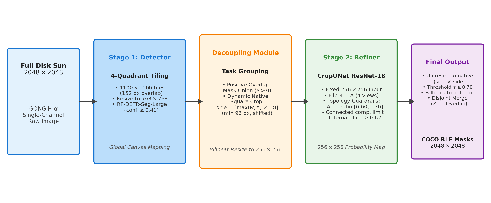
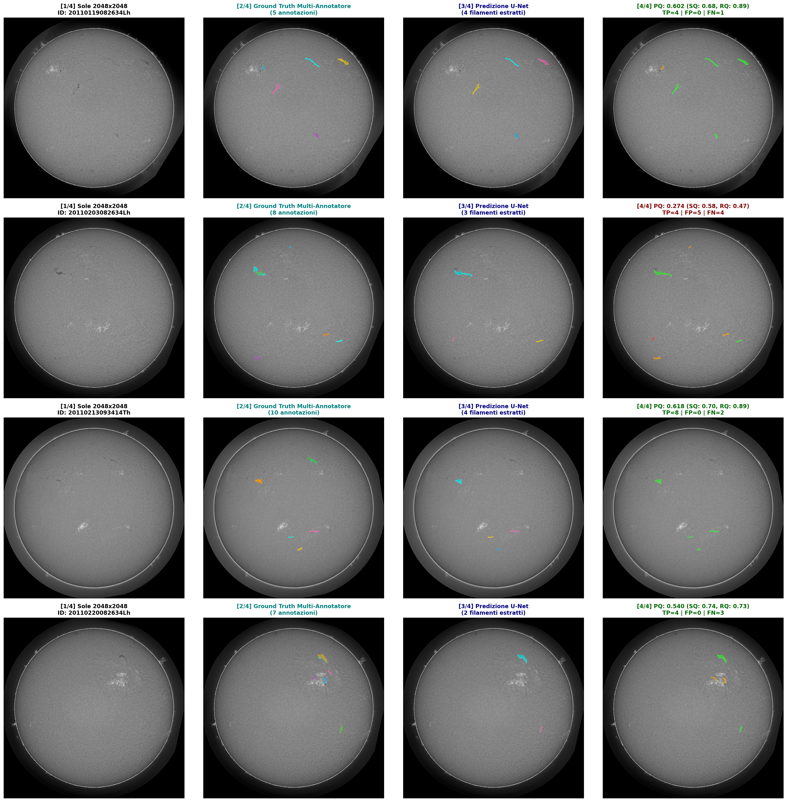

# Decoupled Solar Filament Segmentation Pipeline
### Official Submission to the Solar Filament Segmentation Challenge 2026 (Kaggle)

[](https://www.python.org/downloads/)
[](https://pytorch.org/)
[](https://www.kaggle.com/competitions/filament-segmentation-2026)
[](#evaluation-results)
[](LICENSE)

---

> [!IMPORTANT]
> ### 🔒 IMPORTANT NOTICE FOR THE EVALUATION COMMITTEE: MODEL WEIGHTS ACCESS
> To preserve competitive integrity and prevent unauthorized duplication by other competitors during the active submission phase of the competition, the model checkpoints hosted on Kaggle Model Hub (`spag99/rf-detr-seg-large-tiling-nmm` and `spag99/u-net-resnet-18-refiner`) are currently maintained in **Private** mode.
> 
> **They will be set to Public visibility immediately upon the official close of the competition submissions.**
> 
> **In the meantime, the evaluation committee can access, download, and verify both model checkpoints privately and securely via Google Drive after i confirm their identity, without renaming them:**
>
> 1. **Automated 1-Click Download**:
>    ```bash
>    python download_weights.py
>    ```
>    *(This script automatically fetches both files via Google Drive into `models/` and verifies their cryptographic MD5 hashes).*
>
> 2. **Direct Private Google Drive Links (LIMITED ACCESS, my approval for access is required **:
>    * **Stage 1 Detector (`RF-DETR-SEG-LARGE-TILING-NMM.pth` - 139.4 MB)**:  
>      👉 [Download from Google Drive](https://drive.google.com/file/d/1n2MYBKVQHJTfV5VEDwCm1IjpdPc3R4Jr/view?usp=sharing)  
>      *(Verified MD5: `2fcde57114b2483130ccab596a61bcd7`)*
>    * **Stage 2 Refiner (`final_refiner.pt` - 54.4 MB)**:  
>      👉 [Download from Google Drive](https://drive.google.com/file/d/1bSkYbWXGHP2ydGrjcRe3Cug8aYRT5cDf/view?usp=sharing)  
>      *(Verified MD5: `74991b8d95f7922f0ca6fd75f8ab4f5f`)*
>
> **⚠️ ATTENTION**: Please **do not rename** the downloaded files. Place them directly in the `models/` directory:
> * `models/RF-DETR-SEG-LARGE-TILING-NMM.pth`
> * `models/final_refiner.pt`  
> The pipeline notebook will automatically detect, load, and cryptographically verify them.

---

## 📖 Overview

This repository contains the complete, self-contained, and fully reproducible source code and inference pipeline for our solution to the **[Solar Filament Segmentation Challenge 2026](https://www.kaggle.com/competitions/filament-segmentation-2026)**, organized by the **Earth-Space AI Research (ESAIR) Lab** utilizing the **MAGFiLO** dataset (*Nature Scientific Data*, 2024).

The task is the automated instance segmentation of solar filaments in full-disk Global Oscillation Network Group (GONG) H-$\alpha$ observations ($2048 \times 2048$ pixels), evaluated under **Panoptic Quality (PQ)**.

### 🏆 Key Results
* **Official Kaggle Test Leaderboard**: **0.410 Panoptic Quality (PQ)**
* **Validation Checkpoint Self-Evaluation**:
  * **Mean Dice**: **0.741** (IoU: 0.612)
  * **Panoptic Quality (PQ)**: **0.4871**
  * **Segmentation Quality (SQ)**: **0.6812**
  * **Recognition Quality (RQ)**: **0.7150**
  * **Detection Metrics**: True Positives (TP) = 863, False Positives (FP) = 293, False Negatives (FN) = 395
* **⚡ Real-Time Operational Early Warning**:
  * **High-Throughput Latency**: Under **1.8 seconds per full-disk** ($2048 \times 2048$ px) observation on standard GPU accelerators.
  * **Mission Applicability**: Direct operational capability for real-time cadence monitoring, enabling automated early-warning alerts for filament destabilization, eruptive solar flares, and Coronal Mass Ejections (CMEs).

---

## 🏗️ Architecture & Methodology

Our system resolves the fundamental tension between **memory limitations** and **fine boundary preservation** on $2048 \times 2048$ solar images by decoupling instance detection from high-resolution morphological refinement:



1. **Stage 1 (Global Tiled Detection)**:
   * **RF-DETR-Seg-Large** evaluates four overlapping quadrants ($1100 \times 1100$ px with a 152 px overlap margin), bilinearly downsampled to $768 \times 768$ px.
   * Detections with confidence $\ge 0.41$ are projected onto the global $2048 \times 2048$ coordinate canvas.
2. **Decoupling Module & Positive Overlap Grouping**:
   * Filament candidate masks from adjacent tiles that exhibit positive pixel overlap are merged into single tasks to eliminate boundary seam tears.
   * For each unified task bounding box $[x, y, w, h]$, a **dynamic native square crop** is extracted with an expanded $1.8\times$ context factor:
     $$\text{side} = \min\Big(\max\big(\lceil \max(w, h) \times 1.8 \rceil, \, 96\big), \, 2048\Big)$$
   * The square is shifted (never scaled or distorted) to remain within image bounds, preserving the raw $1:1$ pixel resolution.
3. **Stage 2 (Native-Resolution U-Net Refiner)**:
   * Square crops are resized to $256 \times 256$ px and evaluated by **CropUNet** (ResNet-18 encoder, 182 layers).
   * **Topology-Safe Flip-4 TTA**: Evaluates 4 spatial views (`identity`, `hflip`, `vflip`, `hvflip`) constrained by three strict topological guardrails (area ratio $[0.60, 1.70]$, connected components limit, and internal Dice $\ge 0.62$) to prevent artificial filament fragmentation.
4. **Re-projection & Disjoint Output**:
   * Continuous probability maps ($256 \times 256$) are bilinearly un-resized to native crop dimensions and thresholded at $\tau = 0.70$ (with fallback to the Stage 1 mask if empty).
   * Non-overlapping instances are assembled and encoded into compressed COCO RLE.

---

## 📂 Repository Structure

```
.
├── pipeline_inference.ipynb           # Standalone Jupyter notebook illustrating the entire pipeline
├── download_weights.py                # Automated Google Drive downloader & MD5 verifier
├── requirements.txt                   # All utilized Python packages and versions
├── README.md                          # Reproduction guide & documentation
├── figures/                           # Visualizations, diagrams, and evaluation plots
│   ├── pipeline_diagram.png           # Pipeline architecture diagram
│   ├── validation_gallery.png         # Comparative 4-panel visual validation gallery
│   └── dice_distribution.png          # Empirical Dice score distribution plot
└── models/                            # Target directory for downloaded weights (auto-created)
    ├── RF-DETR-SEG-LARGE-TILING-NMM.pth (139.4 MB)
    └── final_refiner.pt (54.4 MB)
```

---

## 🔒 Checkpoint Verification & MD5 Locks

All model weights are validated against strict MD5 cryptographic hashes to guarantee bit-exact execution:

| Stage | Model Name | Checkpoint Filename | Expected MD5 Hash | Private Google Drive Link |
| :--- | :--- | :--- | :--- | :--- |
| **Stage 1** | RF-DETR-Seg-Large | `RF-DETR-SEG-LARGE-TILING-NMM.pth` | `2fcde57114b2483130ccab596a61bcd7` | [Google Drive](https://drive.google.com/file/d/1n2MYBKVQHJTfV5VEDwCm1IjpdPc3R4Jr/view?usp=sharing) |
| **Stage 2** | CropUNet (ResNet-18) | `final_refiner.pt` | `74991b8d95f7922f0ca6fd75f8ab4f5f` | [Google Drive](https://drive.google.com/file/d/1bSkYbWXGHP2ydGrjcRe3Cug8aYRT5cDf/view?usp=sharing) |

---

## 🚀 Reproduction Instructions

The evaluation committee can reproduce the submitted predictions with zero external friction.

### Option A: Local / Server Reproduction (Recommended)
1. **Clone this repository**:
   ```bash
   git clone https://github.com/<your-username>/solar-filament-segmentation-solution.git
   cd solar-filament-segmentation-solution
   ```

2. **Install dependencies**:
   ```bash
   pip install -r requirements.txt
   ```

3. **Download model checkpoints**:
   ```bash
   python download_weights.py
   ```
   *(Downloads both models directly from Google Drive into `models/` and verifies their MD5 hashes).*

4. **Run the inference pipeline**:
   ```bash
   jupyter notebook pipeline_inference.ipynb
   ```
   The notebook automatically finds the weights in `models/`, validates their MD5 checksums, executes Stage 1 and Stage 2 inference, and writes `submission.csv`.

### Option B: Running on Kaggle
1. Upload `pipeline_inference.ipynb` to a Kaggle Notebook.
2. Select **GPU T4** or **GPU T4 x 2** accelerator.
3. Attach the downloaded `models/` folder as a private Kaggle Dataset (or use the Kaggle Model Hub models once set to Public post-competition).
4. Attach the competition dataset `filament-segmentation-2026`.
5. Run the notebook to generate `submission.csv`.

---

## 📊 Qualitative Validation Gallery

Validation evaluation showing: (1) Raw GONG H-$\alpha$ Sun; (2) Multi-annotator Ground Truth; (3) Decoupled Pipeline Predictions; (4) Instance PQ Diagnostic Map (Green = TP, Red = FP, Blue = FN):



---

## 📜 Attributions & Acknowledgments

* **Stage 2 Foundation**: The U-Net refinement concept, architecture design, and weights (`final_refiner.pt`) are derived from the public work of **Fususu** and **Nomannic19** on Kaggle.
* **Competition Organizers**: Organized by the **Earth-Space AI Research (ESAIR) Lab** and sponsored by the **U.S. National Science Foundation (NSF) National Solar Observatory (NSO)**. Data obtained by the **NSO Integrated Synoptic Program (GONG)**.

---

## 📄 License

This repository is licensed under the [MIT License](LICENSE).
